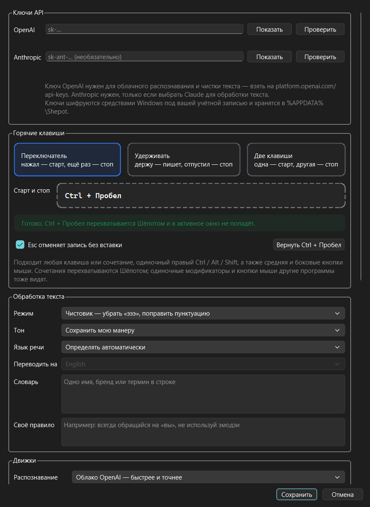
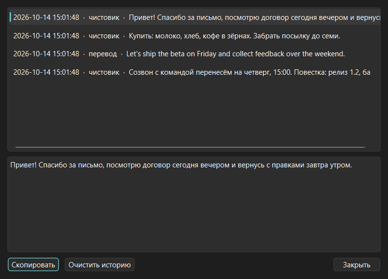

# Shepot

**English** · [Русский](README.ru.md)

Voice typing for Windows in the spirit of [Whisperly](https://whisperly.io/):
press a hotkey, say what you mean, and polished text lands in the active window,
not a raw transcript. Works in any app that has a text field.

*Shepot* (Шёпот) is Russian for "whisper". The interface is in Russian;
dictation works in ~99 languages.


## Features

| | |
|---|---|
| **Modes** | `Clean` removes "uhm"s, stumbles and repeats and adds punctuation. `As is` gives the raw transcript. `Translate` lets you speak one language and inserts another |
| **Tone** | Keep my style / Neutral / Casual / Business |
| **Dictionary** | Names, brands and terms that are always spelled the same way |
| **Custom rule** | Free-form addition to the prompt ("use formal address", "no emoji") |
| **Languages** | Recognition of ~99 languages with auto-detection, translation into 20 languages from a list |
| **Hotkeys** | Any key, key combo, a lone right Ctrl/Alt or a mouse button; toggle, push-to-talk, or two separate keys for start and stop; `Esc` cancels |
| **Engines** | OpenAI cloud or local faster-whisper with no internet |
| **Insertion** | Via the clipboard, by simulated typing, or copy only |
| **History** | Recent dictations, in case the text didn't make it to the window |
| **Screenshots to terminal** | A toggle that turns a clipboard image into a path to a PNG, so `Ctrl+V` works where an image can't be pasted |

<table>
<tr>
<td width="55%"></td>
<td></td>
</tr>
<tr>
<td align="center">Settings</td>
<td align="center">Dictation history (demo entries)</td>
</tr>
</table>

## Installation

You need Windows 10/11 (64-bit), a microphone and an OpenAI API key (see below
for how to get one).

### Quick way: prebuilt release

1. Open [Releases](https://github.com/omertaevalibekai/shepot/releases/latest)
   and download `Shepot-windows-x64.zip`.
2. Unzip it to a folder of your choice, e.g. `Documents\Shepot` (not Program
   Files, which requires admin rights).
3. Run `Shepot.exe`. The build is not code-signed, so Windows SmartScreen will
   show a warning: click **More info → Run anyway**.
4. The **API keys** window opens. Paste your OpenAI key, click "Check", then
   "Save". Done.

To start Shepot with Windows, turn it on in the settings. No Python is needed
for the release build. Local (offline) recognition is not included in the
build; install from source for that, as described below.

### From source

If you want to change the code or need local mode.

#### 1. Python

Download Python 3.11 or newer from [python.org/downloads](https://www.python.org/downloads/)
and run the installer. **On the first screen, tick "Add python.exe to PATH"**,
otherwise the commands below won't find Python.

Check it in PowerShell:

```powershell
python --version      # Python 3.11.x or newer
```

#### 2. Shepot

Either with git:

```powershell
git clone https://github.com/omertaevalibekai/shepot.git
cd shepot
```

or without git: on the repository page click **Code → Download ZIP**, unzip
the archive and open PowerShell in the unzipped folder (in Explorer:
Shift + right-click on an empty area → "Open PowerShell window here").

#### 3. Dependencies and shortcuts

```powershell
pip install -r requirements.txt
python tools\make_icon.py
python tools\create_shortcuts.py
```

This creates "Шёпот" shortcuts on the desktop and in the Start menu. From then
on, launch it with a double-click, no console or commands needed.

#### 4. First run

Launch the shortcut. The icon appears in the system tray (next to the clock;
if you don't see it, check the "^" overflow), and the **API keys** window opens
right away. Paste your OpenAI key, click "Check", then "Save", and you're ready
to dictate.

## OpenAI key

Shepot transcribes speech and cleans up text through the OpenAI API, so you
need your own key. A ChatGPT Plus subscription doesn't cover this: the API is
billed separately, pay as you go.

1. Sign in at [platform.openai.com](https://platform.openai.com/).
2. **Settings → Billing**: add credit. Without a balance the key is still
   created, but requests are rejected with a quota error.
3. [**API keys**](https://platform.openai.com/api-keys) → **Create new secret
   key** → copy the key (`sk-…`). It's shown only once.
4. In Shepot: right-click the tray icon → **Settings → API keys** → paste →
   "Check" → "Save".

For costs, see [OpenAI pricing](https://openai.com/api/pricing/): you pay for
minutes of transcribed speech plus a small text cleanup request. For everyday
dictation the amounts are small; usage is shown under **Settings → Usage**.

### Where the key is stored

Keys are entered in the app itself: right-click the tray icon → **Settings →
API keys**. On first run the window opens by itself, since there's nothing to
dictate with until a key is set.

The "Check" button next to the field makes a live request and tells you
exactly what's wrong: the key was rejected, the quota ran out, there's no
internet, or everything is fine.

Keys are encrypted with Windows DPAPI and stored in
`%APPDATA%\Shepot\secrets.dat`. Only your user account on this machine can
decrypt them: the file is useless if copied to another computer, and the key
is never written to disk in plain text. If you already have an
`OPENAI_API_KEY` environment variable, it is picked up automatically; a key
entered in the app takes precedence.

Only the OpenAI key is required. Anthropic is optional, for those who choose
Claude for text processing.

## Running

Use the shortcut, or:

```powershell
python -m shepot          # with a console, errors are visible
```

The app lives in the system tray. Click the icon to start or stop dictation;
right-click for a menu with modes, history and settings. Launching it a second
time doesn't spawn copies: the already running instance responds.

To have Shepot start with Windows, enable "Start with Windows" in the
settings; it registers itself under `HKCU\...\Run`.

## Building an .exe

If you'd rather not install Python on a machine, build a standalone version:

```powershell
python tools\build_exe.py
python tools\create_shortcuts.py     # repoints the shortcuts to the .exe
```

You get `dist\Shepot\Shepot.exe`; the whole folder can be moved to another
computer. Local recognition is not included in the build, since faster-whisper
pulls in models and CUDA; run from source for that.

The build is not code-signed, so on first launch SmartScreen will show a
warning: click "More info" → "Run anyway".

## How to use

1. Put the cursor in any text field: email, a messenger, a code editor.
2. Press `Ctrl+Space`: an indicator with an audio waveform appears.
3. Speak.
4. Press `Ctrl+Space` again: a couple of seconds later the text is in the
   field.

Hotkeys can be changed in "Settings → Hotkeys": click the field and press what
you want: a combo, a lone right Ctrl or Alt, the middle or a side mouse
button. "Two keys" mode puts start and stop on separate buttons. Shepot
intercepts key combos; lone modifiers and mouse buttons are still seen by
other programs. If a combo is already taken, the settings tell you right away.

## Screenshots to terminal

A console won't accept an image from the clipboard: `Ctrl+V` in a terminal
pastes text and nothing else. So you end up saving the screenshot to a file
and typing the path by hand, which is exactly the chore you want to skip.

Turn on **"Screenshots to terminal"**: right-click the tray icon, it's the
first item under dictation, or tick it in the settings. Then:

1. `Win+Shift+S`: snip a region as usual.
2. `Ctrl+V` in the terminal pastes a path like
   `C:\Users\…\Temp\claude-shots\shot-20260929-190629-096.png`.

The snip is saved as PNG and the clipboard gets the path to it instead of the
image. Paths with spaces are quoted. An image file copied in Explorer is
handled the same way: the clipboard gets the path to the original file, no
copy is made.

The toggle takes effect immediately, no restart needed, and its state is
remembered. While it's off, the clipboard is not touched at all.

In the settings you can change the screenshot folder (default
`%TEMP%\claude-shots`) and how long snips are kept: old ones are cleaned up
when the toggle is turned on, so the folder doesn't grow forever. "Keep
forever" disables the cleanup.

## Troubleshooting

| What you see | What to do |
|---|---|
| `python` not found | Reinstall Python with "Add python.exe to PATH" ticked and open a new PowerShell window |
| Error installing `PyAudio` | Upgrade pip: `python -m pip install --upgrade pip`, then rerun `pip install -r requirements.txt` |
| "Key rejected" | The key wasn't copied in full or was deleted on platform.openai.com; create a new one |
| "Quota exceeded" / 429 | Add credit under Settings → Billing |
| Hotkey does nothing | The combo is taken by another program; change it in Settings |
| Text isn't inserted into the window | The window runs as administrator; see "Good to know" below |
| `Ctrl+V` pastes an image, not a path | "Screenshots to terminal" is off; turn it on in the tray menu |

Run with a console to see error details: `python -m shepot`.

## Latency

Author's measurements, 10 seconds of speech, cloud mode:

| Stage | Time |
|---|---|
| Transcription (`gpt-4o-transcribe`) | 1.1–2.2 s |
| Text processing (`gpt-4o-mini`) | 1.3–1.7 s |
| **From end of recording to text in the window** | **~3.3 s** |

API connections are opened at app startup and whenever settings change;
without that, the first dictation would take 9–10 seconds longer because of
the TLS handshake.

## Local mode

Settings → Engines → Recognition → "Local". You'll need:

```powershell
pip install faster-whisper
```

The model is downloaded on first run and then kept in memory. On a GPU with
6 GB of memory, `small` or `medium` in `float16` is a sensible ceiling;
`large-v3` won't fit. Without an NVIDIA GPU the model runs on the CPU, but
noticeably slower; start with `base` or `small`. Text post-processing can be
turned off ("No processing"); then no internet is needed at all, but you get
the raw transcript without cleanup.

## Processing with Claude

Settings → Engines → Text processing → "Anthropic (Claude)". This needs the
`anthropic` package (`pip install anthropic`) and a key in "Settings → API
keys".

The default is `claude-opus-5`. Requests use minimal effort (`effort: low`),
since otherwise the model thinks longer than the dictation itself lasts, and
the server-side fallback route is enabled (`fallbacks: "default"`): if a
request is declined by the classifier, it is automatically rerouted to another
model. For dictation, `claude-haiku-4-5` is noticeably faster and cheaper:
change the model string in the same field.

## Good to know

- **Elevated windows.** Windows doesn't let a normal process send input to
  windows running as administrator. If you dictate into such a window, the
  text stays in the clipboard: paste it manually, or run Shepot as
  administrator too.
- **Clipboard.** In "Via clipboard" mode the previous clipboard contents are
  restored on a timer (0.6 s by default), because Windows provides no way to
  know when the target app has read the clipboard. If a slow app pastes the
  old contents, increase the delay in the settings or switch to "Simulated
  typing", which doesn't touch the clipboard at all.
- **Simulated typing** is slower than pasting and may behave unexpectedly in
  terminals with "smart" autocompletion.
- **Audio is never saved**: the recording lives in memory until transcription
  finishes. In cloud mode audio is sent to OpenAI; in local mode it never
  leaves the machine. History stores text only, in
  `%APPDATA%\Shepot\history.json`.

## Project layout

```
shepot/
  config.py        settings in %APPDATA%\Shepot\config.json
  secrets.py       API keys encrypted with DPAPI
  audio.py         microphone capture, 16 kHz mono
  stt.py           speech recognition: OpenAI or faster-whisper
  polish.py        prompt assembly and text post-processing
  providers.py     API clients, warm-up and key checks
  inserter.py      text delivery: clipboard or SendInput
  clipshot.py      clipboard image → PNG on disk → path in clipboard
  hotkeys.py       global hotkeys
  hud.py           always-on-top indicator
  settings_ui.py   settings window
  history_ui.py    history window
  resources.py     access to assets/ from source and from the .exe
  startup.py       autostart via the registry
  app.py           controller and tray
  __main__.py      entry point, single instance
tools/
  make_icon.py         draws assets/shepot.ico
  create_shortcuts.py  desktop and Start menu shortcuts
  build_exe.py         builds a standalone Shepot.exe
```
